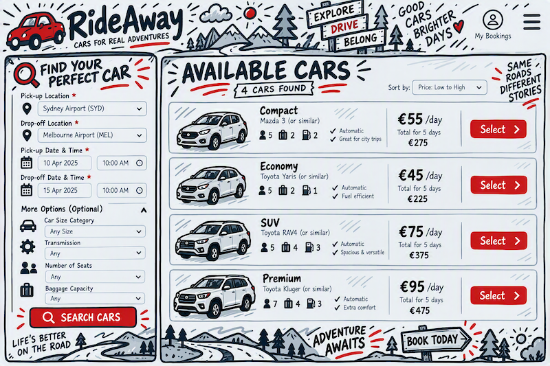
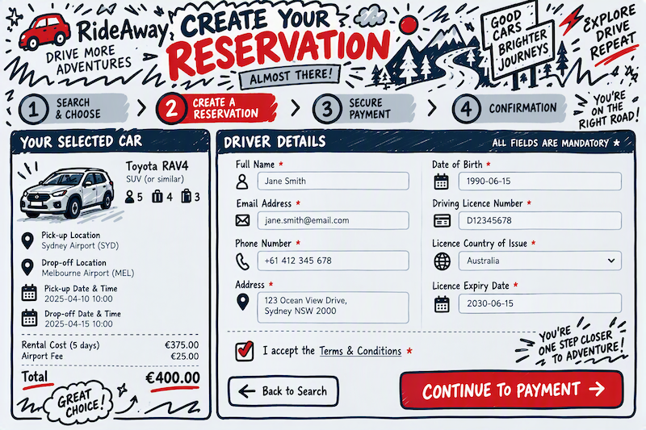
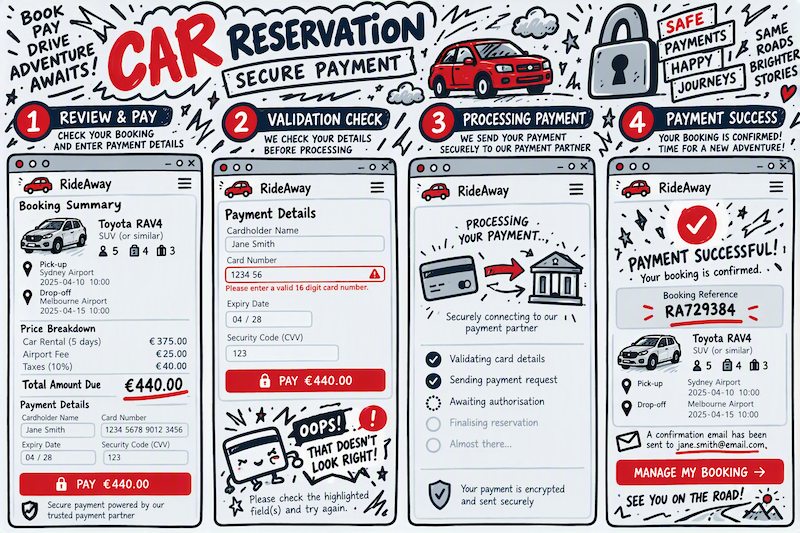
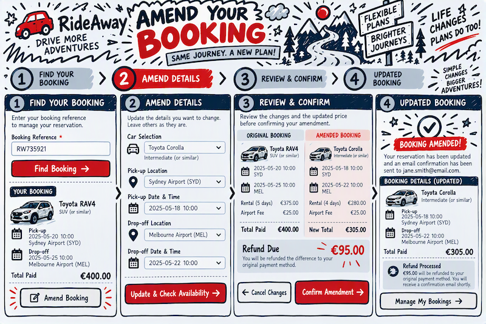
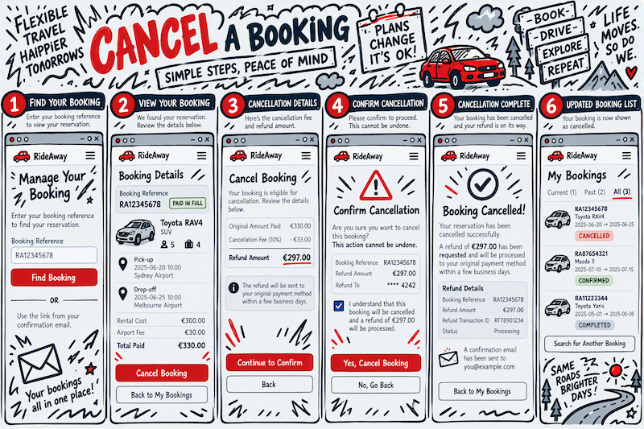
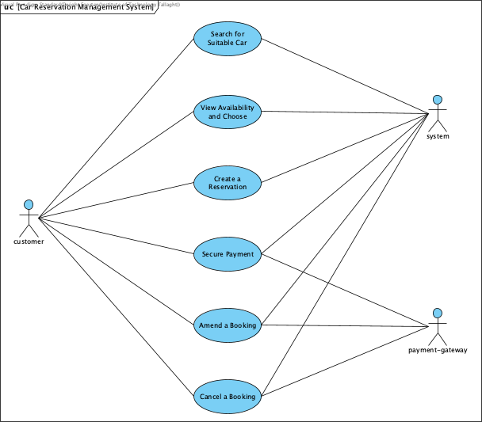

# CMPU3037 | Software Engineering CA Assignment

**Student Name:** *Dwight Egerton*

**Student ID:** *D24127624*

## Deliverable 1

**Deadline:** 22/10/2026

**Instructions:** ***Systems Requirements - A single document containing the following***

* The system should be described in at least two pages of an **overview narrative, which should include any available supporting documentation,
  such as screenshots**, if it is an existing system being enhanced. Mock-ups of screens could also be provided if an existing system is not 
  being modelled. The purpose of this overview is to provide an informal description of what you are thinking of in terms of the application. 

* Apart from the overview, the system requirements must be clearly stated using a UML-based approach - a **Use Case Diagram** should be provided 
  showing **at least 6 use-cases** of the system.

* Extended descriptions/narratives must be provided for 3 of those use-cases where **at least 2 involve user interaction** with the application.

## Table of Contents

<!-- TOC -->
* [1 Overview](#1-overview)
  - [1.1 Scope](#11-scope)
  - [1.2 Overview of System Behaviour](#12-overview-of-system-behaviour)
  - [1.3 Actors](#13-actors)
  - [1.4 Interface Mock-ups](#14-interface-mock-ups)
* [2 Use Cases](#2-use-cases)
  - [2.1 Search for Suitable Car](#21-search-for-suitable-car)
  - [2.2 View Availability and Choose](#22-view-availability-and-choose)
  - [2.3 Create a Reservation](#23-create-a-reservation)
  - [2.4 Secure Payment](#24-secure-payment)
  - [2.5 Amend a Booking](#25-amend-a-booking)
  - [2.6 Cancel a Booking](#26-cancel-a-booking)
<!-- TOC -->

## 1 Overview

For this CA I wouldn't have an applicable work-place example that I could use, so I decided to design **system** based on a real world example that 
most are familiar with. My systems requirements will be based on a **Car Reservation Management System**. As the scope of a full this **system** is 
far bigger than what can be delivered in this CA, I have focused on only the following core processes ... finding a suitable car, creating a 
reservation, taking payment for the booking, as-well-as the ability to manage your booking once made.

### 1.1 Scope

The scope of this deliverable is limited to the 6 core functional areas and the actors described below. Any in-person **customer** interactions
(collection, drop-off, damage inspections, etc.) and management of the car fleet, are outside the scope of the system behaviours and functional
requirements covered in my CA. But would be needed when expanding this to a full implementation. Likewise, the internal implementation of the
**payment-gateway** is out of scope; it is modelled purely as an external actor with a defined request/response contract.

### 1.2 Overview of System Behaviour

I will be focusing the system behaviours and functional requirements of the selected core processes for the **Car Reservation Management System**.

Every **customer** will start their journey by searching for a suitable car that would meet their requirements. This will be shown on the landing 
page presented to the **customer** and will allow them to provide the initial search criteria, such as the pick-up and drop-off location, the dates 
and times, as-well-as size category of the car, transmission, number of seats, baggage space etc..

These criteria will be validated by the **system** to ensure that they are valid and will return a list of available cars that match. The 
**customer** will be presented with the list of available cars (including a representative image of the car and the total cost for the reservation).
The **customer** can additionally filter or sort these results to narrow their search. If the **customer** find a car that meets their needs and 
budget, they will be able to select the respective option to continue with the reservation.

Now that a car has been selected, the **customer** will need to provide their details to process the reservation. The **customer** will need to fill 
in their details: driver's full name, address, contact details, date of birth, driving licence number, licence country of issue and licence expiry 
date. The **system** will validate this information to ensure it is complete and correct. If all checks pass, the reservation will be created 
*PENDING PAYMENT*. This will place a temporary hold on the car awaiting payment and if the **customer** does not complete the payment (leaves without
completing), the reservation will be automatically cancelled.

The final step to complete the reservation would be to take the payment. The **customer** will be presented with a summary of the booking and the 
total amount due, and will be able to enter their payment details. The **system** will pass the payment request to the external **payment-gateway** 
and wait for an authorisation response. Upon receiving the response that the payment for the reservation completed successfully, the **system** will
update the reservation with a unique booking reference and will change the status to *PAID IN FULL* and will proceed to booking management screen. 
Additionally, the **system** will send a confirmation email to the **customer** with the booking reference, the full booking details and a link to be 
able to manage the booking. In the case where the **payment-gateway** returns a failure (processing error or lack of funds), the **system** will 
leave the reservation in the *PENDING PAYMENT* state and will invite the **customer** to try an alternative payment method.

Once a reservation exists, the **customer** can return at any time to browse their current and previous reservations. When browsing reservations 
system will return either the selected reservation (for example, when accessing the reservation from an email link) or a list of all (current, future
and historical) reservations with the respective details of each.

Managing a reservation will have different options available depending on the current state of the reservation. For example, current or historical 
reservations will not allow any changes to be made. But in the event that a **customer** wants to return a car early, this is not in scope for the 
current requirements and will be handled outside the **system**. Upon completion of the rental, the **system** will update the reservation status to 
*COMPLETED*.

In the case that a **customer** wants to cancel a reservation. The **system** would need to first verify if this cancellation can be processed. Key
to this is that cancellations can only be made more than 48 hours before the pick-up date and time. The **system** will calculate any cancellation 
fees and will process the appropriate refund back to the **customer** as-well-as a cancellation confirmation email. The reservation status will then 
be updated to *CANCELLED*.

### 1.3 Actors

As the flow is only focused on the process of making a reservation, the number of actors is limited to the following: -

* **customer** - any member of the public that is looking to book a car for a period of time. They would access the site to create a reservation, 
  pays for it, and subsequently manages that reservation. The **customer** is the principal user of the **system** and the majority of the use-cases 
  are driven by them.
    
* **system** - the **Car Reservation Management System** that is being designed and implemented. This would be responsible managing the reservation 
  process, including the search for available cars, creating a reservation, taking payment and managing the booking once made.
    
* **payment-gateway** - a third-party service that is used to capture card payments as-well-as issue refunds. The **system** never stores raw card 
  details; the **system** only retains the gateway's transaction reference and the authorisation outcome.

### 1.4 Interface Mock-ups

Below are several mockups of what the **Car Reservation Management System** could look like.
These were generated to illustrate the possible functionality and would be subject to change.

#### Search and Select a Car

**Associated Use-case(s):**
* [Search for Suitable Car](#21-search-for-suitable-car)
* [View Availability and Choose](#22-view-availability-and-choose)

#### Create a Reservation

**Associated Use-case(s):**
* [Create a Reservation](#23-create-a-reservation)

#### Secure Payment

**Associated Use-case(s):**
* [Secure Payment](#24-secure-payment)

#### Amend a Booking

**Associated Use-case(s):**
- [Amend a Booking](#25-amend-a-booking)

#### Cancel a Booking

**Associated Use-case(s):**
- [Cancel a Booking](#26-cancel-a-booking)

## 2 Use Cases

The 6 in-scope use-cases below describe the **customer** journey through the **Car Reservation Management System**, from the initial search to 
reservation confirmation as-well-as additional booking management activities that allow for changing or cancelling a reservation.

### 2.1 Search for Suitable Car

| Field                         | Detail                                                                                                                                                                                                                                |
|-------------------------------|---------------------------------------------------------------------------------------------------------------------------------------------------------------------------------------------------------------------------------------|
| **Use Case Name**             | Search for Suitable Car                                                                                                                                                                                                               |
| **Actor(s)**                  | **customer**, **system**                                                                                                                                                                                                              |
| **Goal**                      | To find a suitable car for the customer's rental needs.                                                                                                                                                                               |
| **Overview**                  | The **customer** supplies their rental search criteria via the submission on the landing page and the **system** validates those criteria and determines which cars in the fleet are available for the requested period and location. |
| **Pre-conditions**            | 1. The **customer** is able to access the **system**. 2. It's assumed for this CA that the fleet/location data has been loaded.                                                                                                   |
| **Post-conditions (success)** | The search criteria is valid and returns at least 1 matching car as a result. Each car will be priced for the requested rental period.                                                                                                |
| **Post-conditions (failure)** | In the case where the search criteria matches with no available cars, the **customer** will remain on the search page a message display informing them that "no exact matches" were found.                                            |

#### Successful Scenario

| Step | Actor    | Action                                                                                                                                         |
|------|----------|------------------------------------------------------------------------------------------------------------------------------------------------|
| 1    | customer | Access the **system** and loads the landing page of the **Car Reservation Management System**.                                                 |
| 2    | customer | Required to provide the following core search criteria: pick-up/drop-off location, pick-up/drop-off date & time.                               |
| 3    | customer | Optionally can provide additional criteria to further filter the results: size category, transmission, number of seats, baggage capacity, etc. |
| 4    | customer | Submits the search.                                                                                                                            |
| 5    | system   | Validated that all the required search criteria have been provided.                                                                            |
| 6    | system   | Querying of the fleet based on the search criteria to find all the available matching cars.                                                    |
| 7    | system   | For each of the available cars, calculate the rental total cost: (daily rate × duration) + (any applicable surcharges)                         |
| 8    | system   | Finaly return the results and passes control to **View Availability and Choose**.                                                              |

#### Alternative Scenario(s)

| Step | Condition                                                                                         | Handling                                                                                                                                                  |
|------|---------------------------------------------------------------------------------------------------|-----------------------------------------------------------------------------------------------------------------------------------------------------------|
| 5    | A mandatory field is missing or malformed.                                                        | The **system** rejects and redisplays the form (highlighting the offending field(s)), with the appropriate message. Resumes the flow at step 3.           |
| 5    | The pick-up/drop-off date/time are badly structured (in the past, drop-off before pick-up, etc.). | The **system** rejects and redisplays the form (highlighting the offending field(s)), with the appropriate message. Resumes the flow at step 3.           |
| 6    | No cars match the search criteria.                                                                | The **system** displays a "no exact matches" message and suggests the **customer** revise their search criteia and try again. Resumes the flow at step 3. |

### 2.2 View Availability and Choose

| Field                         | Detail                                                                                                                                                                              |
|-------------------------------|-------------------------------------------------------------------------------------------------------------------------------------------------------------------------------------|
| **Use Case Name**             | View Availability and Choose                                                                                                                                                        |
| **Actor(s)**                  | **customer**, **system**                                                                                                                                                            |
| **Goal**                      | To review available cars, apply filters and sorting, and select a car for reservation.                                                                                              |
| **Overview**                  | The **customer** reviews the list of available cars returned by the search, optionally refines it by filtering and sorting, and selects the car they wish to reserve.               |
| **Pre-conditions**            | A list of available cars was returned by the **system** based on the search criteria.                                                                                               |
| **Post-conditions (success)** | The **customer** selects a suitable car from the options provided (based on their preference and budget), the selection will then be carried forward into **Create a Reservation**. |
| **Post-conditions (failure)** | No car is selected: the **customer** starts over with different search criteria.  The **customer** abandons the session.                                                        |

#### Successful Scenario

| Step | Actor    | Action                                                                                                                                                                                                        |
|------|----------|---------------------------------------------------------------------------------------------------------------------------------------------------------------------------------------------------------------|
| 1    | system   | Displays the list of available cars. Each entry shows a representative image, make/model (or "or similar"), size category, transmission, seats, baggage capacity and the total cost for the requested period. |
| 2    | system   | Displays a summary of the active search criteria along with the available filter and sort controls.                                                                                                           |
| 3    | customer | *(Optional)* Apply additional filters or sorting (price ascending/descending, category, popularity) on the results to narrow their selection options.                                                         |
| 4    | system   | *(Optional)* When filters or sorting are applied, would need to re-render the result list to reflect the changes.                                                                                             |
| 5    | customer | From the results will select the car to be reserved.                                                                                                                                                          |
| 6    | system   | Records the selection against the search session and passes control to **Create a Reservation**.                                                                                                              |

#### Alternative Scenario(s)

| Step | Condition                                                              | Handling                                                                                                                                                  |
|------|------------------------------------------------------------------------|-----------------------------------------------------------------------------------------------------------------------------------------------------------|
| 4    | No cars match the search criteria.                                     | The **system** displays a "no exact matches" message and suggests the **customer** revise their search criteia and try again. Resumes the flow at step 3. |
| 5    | The **customer** chooses to start over with different search criteria. | The **system** returns the **customer** to the search form with the previous criteria pre-populated and passes control to **Search for Suitable Car**.    |

### 2.3 Create a Reservation

| Field                         | Detail                                                                                                                                                                                                                                     |
|-------------------------------|--------------------------------------------------------------------------------------------------------------------------------------------------------------------------------------------------------------------------------------------|
| **Use Case Name**             | Create a Reservation                                                                                                                                                                                                                       |
| **Actor(s)**                  | **customer**, **system**                                                                                                                                                                                                                   |
| **Goal**                      | To create a reservation for a selected car by providing valid contact & driver details.                                                                                                                                                    |
| **Overview**                  | The **customer** supplies the contact & driver details required to create a reservation. The **system** validates those details, creates the reservation in a *PENDING PAYMENT* state Places a temporary hold on the selected car. |
| **Pre-conditions**            | A car has been selected for the requested period.                                                                                                                                                                                          |
| **Post-conditions (success)** | A reservation created with status *PENDING PAYMENT* and a temporary hold has been placed on the selected car for the rental period.                                                                                                        |
| **Post-conditions (failure)** | Car is no longer available: the **customer** is informed the car is no longer available and control is passed to **Search for Suitable Car**. Yhe **customer** abaondons the session: no reservation is created.                        |

#### Successful Scenario

| Step | Actor    | Action                                                                                                                 |
|------|----------|------------------------------------------------------------------------------------------------------------------------|
| 1    | system   | Displays the driver details form together with a summary of the selected car, rental period, locations and total cost. |
| 2    | customer | Enters the driver's full name, address, contact telephone number and email address.                                    |
| 3    | customer | Enters the driver's date of birth, driving licence number, licence country of issue and licence expiry date.           |
| 4    | customer | Accepts the terms & conditions and submits the form.                                                                   |
| 5    | system   | Checks all mandatory fields are present and correctly formatted (email, phone, postcode, licence number pattern).      |
| 6    | system   | Verifies the driver's age against the minimum/maximum age policy for the selected car category.                        |
| 7    | system   | Verifies that the driving licence has not expired and remains valid for the whole rental period.                       |
| 8    | system   | Confirms the car is still available and calculates the final cost, including any additional surcharges.                |
| 9    | system   | Creates the reservation with status *PENDING PAYMENT* and places a time-limited hold on the car.                       |
| 10   | system   | Displays the reservation summary and passes control to **Secure Payment**.                                             |

#### Alternative Scenario(s)

| Step | Condition                                                                       | Handling                                                                                                                                                                                  |
|------|---------------------------------------------------------------------------------|-------------------------------------------------------------------------------------------------------------------------------------------------------------------------------------------|
| 5    | One or more mandatory fields are missing or malformed.                          | The **system** rejects and redisplays the form (highlighting the offending field(s)), with the appropriate message. Resumes the flow at step 2.                                           |
| 6    | The driver outsite the minimum/maximin allowed age.                             | The **system** rejects and redisplays the form (highlighting the offending field(s)), with the appropriate message. Resumes the flow at step 2.                                           |
| 7    | The driving licence has expired, or expires before the drop-off date.           | The **system** rejects and redisplays the form (highlighting the offending field(s)), with the appropriate message. Resumes the flow at step 2.                                           |
| 8    | The car is no longer available.                                                 | The **system** rejects and returns the **customer** to the search form with an explination as to why the reservation could not proceed and passes control to **Search for Suitable Car**. |

### 2.4 Secure Payment

| Field                         | Detail                                                                                                                                                                                                                                             |
|-------------------------------|----------------------------------------------------------------------------------------------------------------------------------------------------------------------------------------------------------------------------------------------------|
| **Use Case Name**             | Secure Payment                                                                                                                                                                                                                                     |
| **Actor(s)**                  | **customer**, **system**, **payment-gateway**                                                                                                                                                                                                      |
| **Goal**                      | To securely process the payment for a reservation and send confirmation of the reservation.                                                                                                                                                        |
| **Overview**                  | The **customer** pays for the reservation. The **system** forwards the payment request to the external **payment-gateway**, interprets the authorisation response, confirms the reservation and issues a booking reference and confirmation email. |
| **Pre-conditions**            | 1. A reservation exists with status *PENDING PAYMENT*. 2. The temporary hold on the car has not yet expired. 3. The **payment-gateway** is reachable.                                                                                      |
| **Post-conditions (success)** | The reservation is update with a unique booking reference, the gateway transaction referenceand the status is update to *PAID IN FULL* Additionally, a confirmation email will been sent.                                                      |
| **Post-conditions (failure)** | The reservation remains in the *PENDING PAYMENT* state, the hold is retained for the remainder of its timer and the **customer** is invited to try an alternative payment method.                                                                  |

#### Successful Scenario

| Step | Actor           | Action                                                                                                                                                          |
|------|-----------------|-----------------------------------------------------------------------------------------------------------------------------------------------------------------|
| 1    | system          | Displays the payment page with a summary of the booking (car, locations, dates/times, driver) and the total amount due, itemised with any surcharges and taxes. |
| 2    | customer        | Enters the cardholder name, card number, expiry, and security code. Will then submits the payment request.                                                  |
| 3    | system          | Checks the card details are correct.                                                                                                                            |
| 4    | system          | Submits a payment request to the **payment-gateway** over a secure channel.                                                                                     |
| 5    | payment-gateway | Processes the request and returns an authorisation response containing the outcome and a transaction reference.                                                 |
| 6    | system          | Receives an *approved* response and stores only the transaction reference and the authorisation outcome.                                                        |
| 7    | system          | Allocates a unique booking reference and updates the reservation status to *PAID IN FULL*.                                                                      |
| 8    | system          | Converts the temporary hold into a firm allocation of the car for the rental period.                                                                            |
| 9    | system          | Sends an email to the **customer** with the booking reference, the full booking details, and a link to manage the booking.                                      |
| 10   | system          | Displays the confirmation screen and navigates the **customer** to the booking management screen.                                                               |

#### Alternative Scenario(s)

| Step | Condition                                                                               | Handling                                                                                                                                                                           |
|------|-----------------------------------------------------------------------------------------|------------------------------------------------------------------------------------------------------------------------------------------------------------------------------------|
| 3    | The card details are incomplete or fail format validation.                              | The **system** rejects and redisplays the form (highlighting the offending field(s)), with the appropriate message. Resumes the flow at step 2.                                    |
| 5    | The **payment-gateway** declines the payment (insufficient funds).                      | The **system** leaves the reservation at *PENDING PAYMENT*, displays the decline reason and invites the **customer** to use an alternative payment method. Flow resumes at step 2. |
| 5    | The **payment-gateway** rejects the payment for a processing error (e.g. invalid card). | The **system** leaves the reservation at *PENDING PAYMENT*, displays the decline reason and invites the **customer** to use an alternative payment method. Flow resumes at step 2. |

### 2.5 Amend a Booking

| Field                         | Detail                                                                                                                                                                                                                                                                                                   |
|-------------------------------|----------------------------------------------------------------------------------------------------------------------------------------------------------------------------------------------------------------------------------------------------------------------------------------------------------|
| **Use Case Name**             | Amend a Booking                                                                                                                                                                                                                                                                                          |
| **Actor(s)**                  | **customer**, **system**, **payment-gateway**                                                                                                                                                                                                                                                            |
| **Goal**                      | Amend an existing reservation and process any applicable refund.                                                                                                                                                                                                                                         |
| **Overview**                  | The **customer** retrieves an existing reservation and amends the permitted details - the rental dates/times, the pick-up or drop-off location, the car selected, or the driver contact details. The **system** re-validates availability, re-prices the booking and collects or refunds any difference. |
| **Pre-conditions**            | 1. A reservation exists with status *PAID IN FULL*. 2. The pick-up date and time is more than 48 hours in the future.                                                                      |
| **Post-conditions (success)** | The reservation is updated with the amended details, re-priced, and any price difference has been collected or refunded. The status remains *PAID IN FULL* and an updated confirmation email has been sent.                                                                                              |
| **Post-conditions (failure)** | The original reservation is left completely unchanged.                                                                                                                                                                                                                                                   |

#### Successful Scenario

| Step | Actor           | Action                                                                                                                                                                    |
|------|-----------------|---------------------------------------------------------------------------------------------------------------------------------------------------------------------------|
| 1    | customer        | Opens the booking management screen and supplies the booking reference (or follows the emailed link).                                                                     |
| 2    | system          | Locates and displays either the single selected reservation or selects from the list of current, future and historical reservations.                                      |
| 3    | customer        | Selects the reservation to amend and chooses "Amend booking".                                                                                                             |
| 4    | system          | Checks the reservation is eligible for amendment (status *PAID IN FULL* and it's more than 48 hours before pick-up) and displays the amendable fields.                    |
| 5    | customer        | Changes one or more of: pick-up/drop-off date & time, pick-up/drop-off location, car selection, driver contact details and submits the amendment.                         |
| 6    | system          | Validates the amended criteria using the same rules and re-checks availability for the amended period/car.                                                                |
| 7    | system          | Recalculate the total cost and determines the difference against the amount already paid, applying any amendment to the charged fee.                                      |
| 8    | system          | Presents the **customer** with a clear before/after summary and the balance to pay or to be refunded and confirms the amendment.                                          |
| 9    | system          | Where a balance is payable, requests authorisation from the **payment-gateway**. Where a refund is due, requests a refund against the original transaction reference. |
| 10   | payment-gateway | Returns the authorisation or refund outcome and a transaction reference.                                                                                                  |
| 11   | system          | Updates the reservation with the amended details, releases the hold on the previously allocated car (if changed) and allocates the new one.                               |
| 12   | system          | Sends an updated confirmation email retaining the original booking reference, and redisplays the booking management screen.                                               |

#### Alternative Scenario(s)

| Step | Condition                                                                               | Handling                                                                                                                                                                           |
|------|-----------------------------------------------------------------------------------------|------------------------------------------------------------------------------------------------------------------------------------------------------------------------------------|
| 2    | The booking reference is not recognised.                                                | The **system** displays "booking not found" without disclosing whether the reference exists, and resumes at step 1.                                                                |
| 3    | The reservation is *COMPLETED*, *CANCELLED*, or currently in progress.                  | Access to amend the booking would not be available, so the **customer** would not be able to proceed. Resumes at step 1.                                                           |
| 4    | The pick-up is 48 hours or less away.                                                   | Access to amend the booking would not be available, so the **customer** would not be able to proceed. Resumes at step 1.                                                           |
| 6    | The amended dates or car are not available.                                             | The **system** informs the **customer** and would suggest available alternatives and resumes at step 5. The original reservation remains unchanged.                            |
| 7    | The amendment results in no price change.                                               | Skips ahead and continues from step 11.                                                                                                                                            |
| 9    | The **customer** declines the revised price.                                            | The **system** discards the amendment and returns to step 2 with the reservation unchanged.                                                                                        |
| 10   | The **payment-gateway** declines the payment (insufficient funds).                      | The **system** leaves the reservation at *PENDING PAYMENT*, displays the decline reason and invites the **customer** to use an alternative payment method. Flow resumes at step 5. |
| 10   | The **payment-gateway** rejects the payment for a processing error (e.g. invalid card). | The **system** leaves the reservation at *PENDING PAYMENT*, displays the decline reason and invites the **customer** to use an alternative payment method. Flow resumes at step 5. |

### 2.6 Cancel a Booking

| Field                         | Detail                                                                                                                                                                                                                                                                                                                                   |
|-------------------------------|------------------------------------------------------------------------------------------------------------------------------------------------------------------------------------------------------------------------------------------------------------------------------------------------------------------------------------------|
| **Use Case Name**             | Cancel a Booking                                                                                                                                                                                                                                                                                                                         |
| **Actor(s)**                  | **customer**, **system**, **payment-gateway**                                                                                                                                                                                                                                                                                            |
| **Goal**                      | Cancel an existing reservation and process any applicable refund.                                                                                                                                                                                                                                                                        |
| **Overview**                  | The **customer** cancels an existing reservation. The **system** verifies that the cancellation is permitted, calculates any cancellation fee, requests the appropriate refund from the **payment-gateway**. Will releases the car back to the available fleet. Finall will send a confirmation email regarding the cancellation. |
| **Pre-conditions**            | 1. A reservation exists with status *PAID IN FULL*. 2. The **customer** has retrieved the reservation via the booking reference or the emailed management link.                                                                                                                                                                      |
| **Post-conditions (success)** | The reservation status is *CANCELLED* and car will be released back into the available pool. Any refund due will be issued and a cancellation confirmation email is sent.                                                                                                                                                            |
| **Post-conditions (failure)** | The reservation remains in its original state, the car remains allocated and no refund is issued.                                                                                                                                                                                                                                        |

#### Successful Scenario

| Step | Actor           | Action                                                                                                                                          |
|------|-----------------|-------------------------------------------------------------------------------------------------------------------------------------------------|
| 1    | customer        | Opens the booking management screen and supplies the booking reference (or follows the emailed link).                                           |
| 2    | system          | Locates and displays either the single selected reservation or selects from the list of current, future and historical reservations.            |
| 3    | customer        | Selects the reservation to cancel and chooses "Cancel booking".                                                                                 |
| 4    | system          | Checks the reservation is eligible for cancellation (status *PAID IN FULL* and it's more than 48 hours before pick-up).                         |
| 5    | system          | Calculates any applicable cancellation fee and the resulting refund amount, and displays them to the **customer**.                              |
| 6    | system          | Asks the **customer** to explicitly confirm the cancellation, making it clear that the action cannot be undone.                                 |
| 7    | customer        | Confirms the cancellation.                                                                                                                      |
| 8    | system          | Sends a refund request to the **payment-gateway** for the calculated amount, quoting the original transaction reference.                        |
| 9    | payment-gateway | Processes the refund and returns the outcome together with a refund transaction reference.                                                      |
| 10   | system          | Stores the refund transaction reference and updates the reservation status to *CANCELLED*.                                                      |
| 11   | system          | Releases the car for the cancelled period back into the available fleet.                                                                        |
| 12   | system          | Sends a cancellation confirmation email containing the booking reference, the cancelled booking details, any fee charged and the refund amount. |
| 13   | system          | Redisplays the booking management screen showing the reservation as *CANCELLED*.                                                                |

#### Alternative Scenario(s)

| Step | Condition                                                              | Handling                                                                                                                                                                               |
|------|------------------------------------------------------------------------|----------------------------------------------------------------------------------------------------------------------------------------------------------------------------------------|
| 2    | The booking reference is not recognised.                               | The **system** displays "booking not found" without disclosing whether the reference exists, and resumes at step 1.                                                                    |
| 3    | The reservation is *COMPLETED*, *CANCELLED*, or currently in progress. | Access to cancel the booking would not be available, so the **customer** would not be able to proceed. Resumes at step 1.                                                              |
| 4    | The pick-up is 48 hours or less away.                                  | Access to cancel the booking would not be available, so the **customer** would not be able to proceed. Resumes at step 1.                                                              |
| 5    | The cancellation fee equals the amount paid, so no refund is due.      | The **system** clearly states that no refund will be issued and on confirmation skips straight to step 10.                                                                             |
| 7    | The **customer** declines the confirmation.                            | The **system** abandons the cancellation and returns to step 2 with the reservation unchanged.                                                                                         |
| 9    | The **payment-gateway** rejects the refund.                            | The **system** does not cancel the reservation. It logs the failure, flags the booking for manual follow-up and informs the **customer** that the cancellation could not be completed. |

