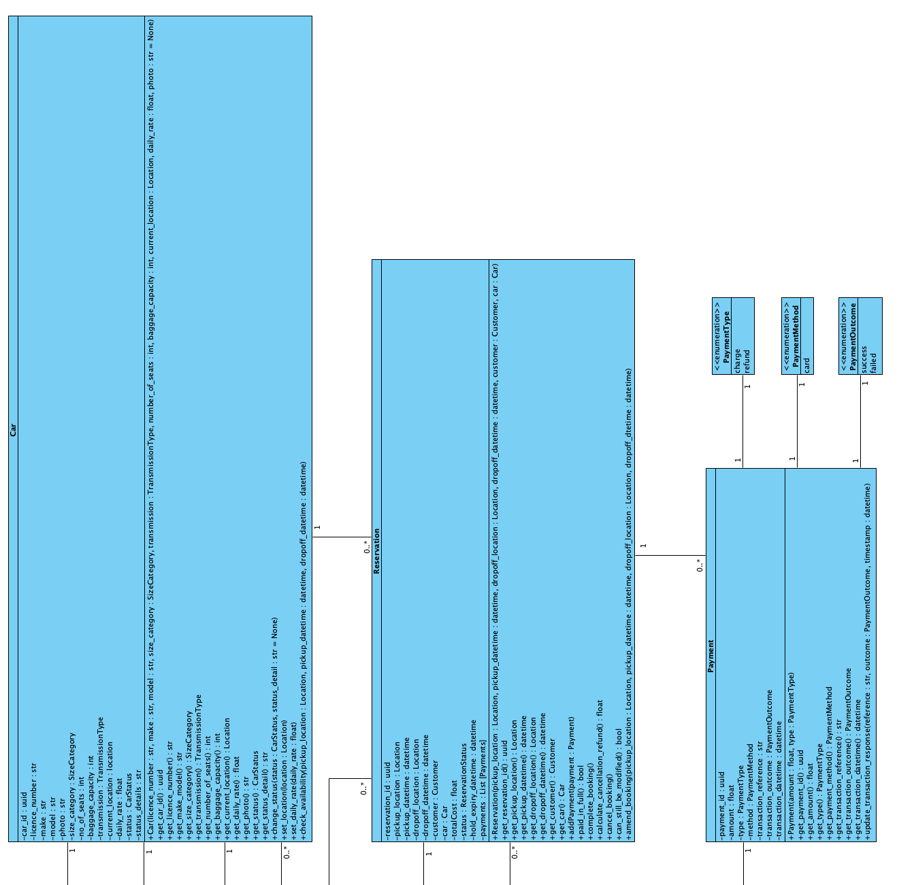
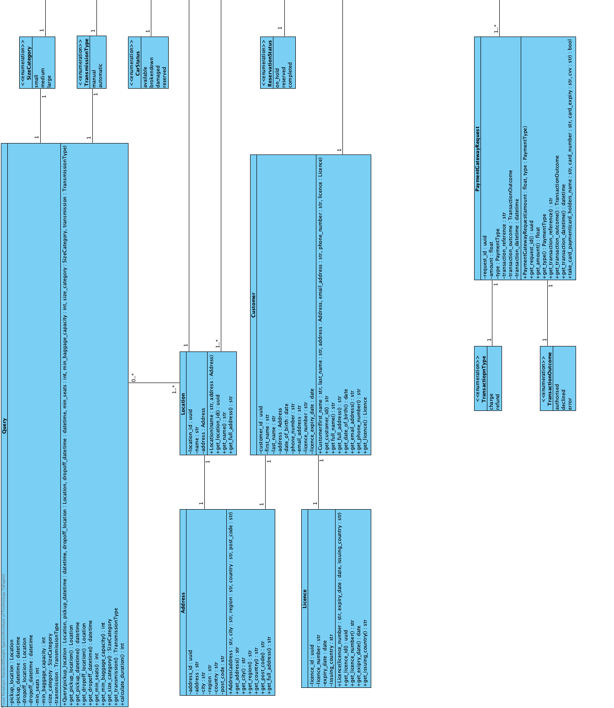

# CMPU3037 | Software Engineering CA Assignment

**Student Name:** *Dwight Egerton*

**Student ID:** *D24127624*

## Deliverable 2

**Deadline:** 12/11/2026

**Instructions:** ***Object Model - A single document / image containing the following***

* The object model (conceptual class diagram) identified from the system requirements.
* Should contain classes for all your domain objects, the associations between the classes and any class attributes that are required.
* There is no need to include operations at this point.

## Table of Contents

<!-- TOC -->
* [1 Overview](#1-overview)
  - [1.1 Class Identification](#11-class-identification)
* [2 Object Model](#2-object-model)
  - [2.1 Class Diagram](#21-class-diagram)
<!-- TOC -->

## 1 Overview

For this CA I wouldn't have an applicable work-place example that I could use, so I decided to design **system** based on a real world example that 
most are familiar with. My systems requirements will be based on a **Car Reservation Management System**. As the scope of a full **system** is 
far bigger than what can be delivered in this CA, I have focused on only the following core processes ... finding a suitable car, creating a 
reservation, taking payment for the booking, as-well-as the ability to manage your booking once made.

### 1.1 Class Identification

Using the *Noun Identification Technique*, the **Car Reservation Management System** requirements and in-scope delivery can be refined into the 
following high-level classes: -

| Stage 1                                        | Stage 2                                                                                                             | Final Class               |
|------------------------------------------------|---------------------------------------------------------------------------------------------------------------------|---------------------------|
| **System / Car Reservation Management System** | It represents the entire software application environment, not an isolated class. *Excluded*                        |                           |
| **Search Criteria / Filter**                   | Transient user input parameter session structures used for querying.                                                | **Query**                 |
| **Customer / Principal User**                  | This represents a primary external actor interacting with the system.                                               | **Customer**              |
| **Car / Fleet**                                | Represents the physical vehicles and matching vehicle listings available for rent.                                  | **Car**                   |
| **Reservation / Booking**                      | The central entity holding transaction entries, schedule periods, references, and statuses.                         | **Reservation**           |
| **Location (Pick-up / Drop-off)**              | A distinct entity tracking rental branch locations/offices.                                                         | **Location**              |
| **Date / Time / Duration**                     | This is a fundamental data attribute handled by primitive types or standard library objects. *Excluded (attribute)* |                           |
| **Size Category / Transmission**               | Descriptive attributes classification belonging directly to a `Car`. *Excluded (attribute)*                         |                           |
| **Baggage Space / Number of Seats**            | Design specifications or attributes belonging directly to a `Car`. *Excluded (attribute)*                           |                           |
| **Total Cost / Rental Fee / Surcharge**        | Numeric values computed dynamically by the system using system business rules. *Excluded (attribute)*               |                           |
| **Driver Details (Full Name, Address, DoB)**   | Demographics collected on the driver; can be modeled as a standalone entity or part of `Customer`.                  | **Customer**              |
| **Driving Licence (Number, Country, Expiry)**  | Critical domain item containing unique operational rules and expiration checks.                                     | **DrivingLicence**        |
| **Payment Details / Card Details**             | Sensitive data temporary inputs; explicitly never stored raw by the application.                                    | **Payment**               |
| **Payment Gateway**                            | An external third-party actor interface, handled via an abstraction layer.                                          | **PaymentGatewayRequest** |
| **Transaction Reference / Booking Reference**  | Unique string identity attributes assigned to a `Reservation` or payment. *Excluded (attribute)*                    |                           |
| **Confirmation Email**                         | A transient notification communication layer or external boundary utility. *Excluded (out-of-scope)*                |                           |

---

| Noun Identification                                           | Final Class               |
|---------------------------------------------------------------|---------------------------|
| **System / Car Reservation Management System** (out-of-scope) |                           |
| **Search Criteria / Filter**                                  | **Query**                 |
| **Customer / Principal User**                                 | **Customer**              |
| **Car / Fleet**                                               | **Car**                   |
| **Reservation / Booking**                                     | **Reservation**           |
| **Location (Pick-up / Drop-off)**                             | **Location**              |
| **Date / Time / Duration** (attribute)                        |                           |
| **Size Category / Transmission** (attribute)                  |                           |
| **Baggage Space / Number of Seats** (attribute)               |                           |
| **Total Cost / Rental Fee / Surcharge** (attribute)           |                           |
| **Driver Details (Full Name, Address, DoB)**                  | **Customer**              |
| **Driving Licence (Number, Country, Expiry)**                 | **DrivingLicence**        |
| **Payment Details / Card Details**                            | **Payment**               |
| **Payment Gateway**                                           | **PaymentGatewayRequest** |
| **Transaction Reference / Booking Reference** (attribute)     |                           |
| **Confirmation Email** (out-of-scope)                         |                           |

## 2 Object Model

Below is the object model (class-diagram) for the **Car Reservation Management System**. The model contains the classes for all the domain objects I 
was able to identify and the respective associations between the classes and any class attributes that are required. I have additionally identified
several properties that would be better defined as enumerations, as they are a finite set of values that can be used to describe them. These have
been included these in the class diagram.

### 2.1 Class Diagram

